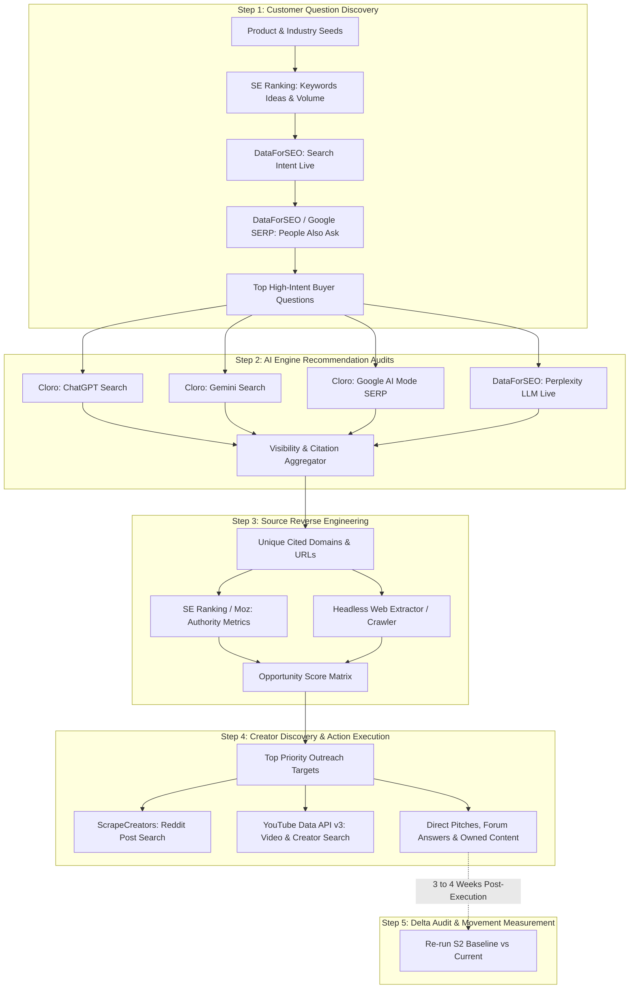

# aeo-audit

An agent skill for Claude Code, Codex and other coding agents. It audits how ChatGPT, Gemini, Perplexity and Google AI Mode recommend your brand, finds the sources they cite, and plans the Reddit, YouTube and on-site work to get you into those answers. Every step stops at a gate for your approval.

## Demo

[](https://github.com/SneharupMukherjee/aeo-audit-skill/raw/main/media/demo.mp4)

click the preview for the full video with sound.

## Install

```bash
git clone https://github.com/SneharupMukherjee/aeo-audit-skill ~/.claude/skills/aeo-audit
```

Needs keys for SE Ranking, DataForSEO, Cloro and ScrapeCreators. 

## Files

- `SKILL.md`: the skill the agent reads
- `docs/`: workflow spec and formulas

---

## AEO (Answer Engine Optimization) Workflow — Technical Specification & API Playbook

## Overview
This technical document specifies the complete **Answer Engine Optimization (AEO)** workflow.

AEO audits and optimizes how AI engines (such as ChatGPT, Gemini, Perplexity, and Google AI Overview) discover, cite, and recommend products. The workflow spans five stages:
1. **Demand Discovery**: Extract high-intent commercial and transactional buyer questions.
2. **AI Recommendation Audit**: Measure brand visibility, position, and share of voice across generative search engines.
3. **Source Reverse Engineering**: Analyze cited web pages and calculate infiltration opportunity scores.
4. **Creator & Community Outreach**: Locate high-influence Reddit threads, YouTube channels, and owned-page gaps.
5. **Delta Audit**: Benchmark movement 3–4 weeks post-execution against an established baseline.

---

## High-Level Workflow Architecture



---

## Step 01: What Customers Ask (Demand Discovery)

## Objective
Uncover the exact transactional and commercial questions prospective buyers ask when preparing to purchase, scoring candidates based on Search Volume, CPC, Intent, and Keyword Difficulty.

---

## 1. Prompt Specification

```text
Run Step 1 of the AEO workflow:

1. For each seed topic provided, query SE Ranking:
   Endpoint: `https://api.seranking.com/v2/keywords/ideas` (GET, limit=40, sort=volume).
   Retrieve: monthly search volume (vol), cost per click (CPC), and keyword difficulty (diff).
   Merge, deduplicate, and discard off-topic rows (list rejected entries).

2. Query DataForSEO for search intent:
   Endpoint: `https://api.dataforseo.com/v3/dataforseo_labs/google/search_intent/live`
   Intent Multipliers: Transactional = 1.0 | Commercial = 0.8 | Informational = 0.2 | Navigational = 0.0.
   Compute BuyerScore = Intent * (0.50 * C + 0.35 * V + 0.15 * E)
     where C = minmax(CPC), V = minmax(log10(1 + vol)), E = 1 - (diff / 100).
   Filter and retain only keywords where Intent >= 0.8.

3. Cluster synonymous and plural keywords into groups, assign group score = max(BuyerScore). Keep the top 8 groups.
   Gate 1: Render table [keyword | intent | CPC weight | vol weight | diff weight | final score], plus top 5 cut keywords with explanation. Wait for approval.

4. Query Google SERP organically for each group to fetch 'People Also Ask' (PAA):
   Endpoint: `https://api.dataforseo.com/v3/serp/google/organic/live/advanced`
   Filter for comparison/purchase questions.
   Compute QuestionScore = max(BuyerScore) * (1 + 0.1 * (F - 1)), where F = number of groups sharing the question.
   Limit to <= 10 questions rewritten in format: [situation] + [need] + "which should I buy?".

Gate 2: Present table [rank | question | source PAA | BuyerScore | F | QuestionScore] for final sign-off.
```

---

## 2. API Integration Contracts

| Purpose | Provider | Endpoint | Request Details | Output Fields |
| :--- | :--- | :--- | :--- | :--- |
| **Keyword Ideas & Volume** | **SE Ranking** | `GET /v2/keywords/ideas` | Headers: `Authorization: Token <KEY>`<br>Params: `keyword=<seed>`, `country_code=us`, `limit=40` | `volume`, `cpc`, `competition`, `difficulty` |
| **Search Intent** | **DataForSEO** | `POST /v3/dataforseo_labs/google/search_intent/live` | Body: `[{"keywords": ["...", "..."], "language_code": "en"}]` | `intent` (`transactional`, `commercial`, etc.), `secondary_intent` |
| **People Also Ask (PAA)** | **DataForSEO** | `POST /v3/serp/google/organic/live/advanced` | Body: `[{"keyword": "<group_keyword>", "depth": 10}]` | `items[type="people_also_ask"].items[].title` |

---

## Step 02: Who Does AI Recommend? (AI Engine Audits)

## Objective
Audit the 4 major generative search engines in parallel to determine brand visibility, mention positions, cited sources, and brand share of voice.

---

## 1. Prompt Specification

```text
Run Step 2 of the AEO audit across AI search providers in parallel (timeout: 300s):

1. Query each engine with the top verified buyer questions:
   - ChatGPT: Query Cloro API at `/cloro/ai-search/chatgpt/scrape`
   - Gemini: Query Cloro API at `/cloro/ai-search/gemini/scrape`
   - Google AI Mode: Query Cloro API at `/cloro/google/serp/ai_mode` (with target gl/hl)
   - Perplexity: Query DataForSEO API at `/v3/ai_optimization/perplexity/llm_responses/live`

2. For each synthesized answer, extract:
   - m: brand mentioned? (1 if yes, 0 if no)
   - p: rank/position of mention (1st named = 1, 2nd = 2; m/p = 0 if unmentioned)
   - n: total competitor brands named in the answer
   - c: user's own domain quoted in citations (1 or 0)

3. Compute Visibility Metrics:
   - Visibility Score (VS) = mean( 100 * (0.50 * m + 0.30 * (m / p) + 0.20 * c) )
   - Mention Rate = sum(m) / N
   - Share of Voice = sum(m) / sum(n)
   - Competitor Score (CompScore_b) = 100 * sum(m / p) / N

4. Source Citation Analysis:
   - Citation Weight (Cite) = sum(1 / source_position)
   - Infiltration (Vis) = 100 * Cite / N
   - Influence = Vis / max(Vis)
   - Domain Score = Cite * (1 + 0.1 * (Q - 1)) * (1 + 0.1 * (E - 1)) where Q = questions citing it, E = engines citing it.

Gate 3: Run Question 1 across all 4 engines and present citation breakdown.
Gate 4: Execute full question batch. Render scoreboard: VS, Mention Rate, Competitor Share, Question x Engine grid, and top 15 cited domains.
```

---

## 2. API Integration Contracts

| Engine | Provider | Endpoint | Key Parameters | Extracted Data |
| :--- | :--- | :--- | :--- | :--- |
| **ChatGPT** | **Cloro** | `POST /cloro/ai-search/chatgpt/scrape` | `{"prompt": "<question>", "web_search": true}` | Synthesized markdown answer, source citation URLs & rankings |
| **Gemini** | **Cloro** | `POST /cloro/ai-search/gemini/scrape` | `{"prompt": "<question>", "grounding": true}` | Text response, GroundingChunks, search entry point URLs |
| **Google AI Mode** | **Cloro / DataForSEO** | `POST /cloro/google/serp/ai_mode` or `/v3/serp/google/ai_mode/live/advanced` | `{"keyword": "<question>", "gl": "us", "hl": "en"}` | AI Overview text, carousel sources, referenced links |
| **Perplexity** | **DataForSEO** | `POST /v3/ai_optimization/perplexity/llm_responses/live` | `{"prompt": "<question>", "search_domain_filter": []}` | LLM answer, search results cited, domain citations |

---

## Step 03: Reverse Engineer AI Answers (Source Infiltration)

## Objective
Evaluate every URL and domain cited by the AI engines. Determine domain authority, identify existing backlink vectors, and score partnership opportunities.

---

## 1. Prompt Specification

```text
Run Step 3 of the AEO workflow:

1. Normalize cited pages: Strip query parameters and anchors, deduplicate, and exclude direct competitor brand domains and general retailers.
2. Query SEO authority metrics via SE Ranking / Moz API:
   - Endpoints: `POST /v2/analytics/backlinks/overview` or Moz URL Metrics.
   - Measure Page Authority (PA) and Domain Authority (DA) for the top 12 most-quoted pages.
   
Gate 5: Present scatterplot of PA vs. Citation Visibility (identifying top-left quadrant high-visibility, lower-authority targets for easy wins).

3. Extract content and metadata from the top 15 cited URLs using a headless web extractor:
   - Extract: listed brands, comparison criteria, publication date, author, contact links/affiliate disclaimers, and topical alignment.
   
4. Compute Opportunity Score (Opp):
   Opp = 0.40 * Influence + 0.20 * Gap + 0.15 * (1 - PA / 100) + 0.15 * Access + 0.10 * Fresh
   - Gap: 1.0 (rival present, brand absent) | 0.5 (both absent) | 0.0 (brand already present)
   - Access: 1.0 (explicit contact / affiliate program) | 0.5 (author email/byline) | 0.0 (no route)
   - Fresh: 1.0 (updated <= 12 mo) | 0.5 (updated <= 24 mo) | 0.0 (> 24 mo)

Gate 6: Render stacked Opp horizontal bars for the top 10 actionable targets with fit rationale.
```

---

## 2. API Integration Contracts

| Purpose | Provider | Endpoint | Parameters | Extracted Fields |
| :--- | :--- | :--- | :--- | :--- |
| **Domain & URL Authority** | **SE Ranking / Moz** | `GET /v2/analytics/backlinks/overview` | `url=<target_url>` | `domain_trust_score` (DA), `page_trust_score` (PA), `total_backlinks` |
| **Competitor Linking Domains**| **SE Ranking** | `GET /v2/analytics/backlinks/referring-domains` | `domain=<competitor.com>` | `referring_domains[]`, trust rank, first seen |
| **Deep Page Extraction** | **Headless Crawler** (Firecrawl / Playwright) | `POST /v1/scrape` | `{"url": "<target_url>", "formats": ["markdown"]}` | Body content, author, published date, outbound affiliate links |

---

## Step 04: Get on the Map (Outreach & Content Engine)

## Objective
Locate the specific creators, journalists, and discussion threads that fuel AI training and RAG ingestion, generating targeted pitches and authoritative content.

---

## 1. Prompt Specification

```text
Run Step 4 of the AEO workflow:

0. Gate 7: Verify product facts extracted from user website and confirm question alignment.
1. Target Review Sites & Blogs:
   - Impact = Opp (from Step 3).
   - Generate tailored outreach pitch (<= 120 words) addressing specific missing features or factual corrections.

2. Reddit Community Discovery via ScrapeCreators:
   - Endpoint: `POST https://api.scrapecreators.com/v1/reddit/search/posts`
   - Parameters: Keyword phrases of top questions, time_filter='year', sort='relevance'.
   - Impact Formula:
     Impact_reddit = 0.4 * minmax(log10(1 + upvotes + 2 * comments)) + 0.3 * exp(-days / 180) + 0.2 * Relevance + 0.1 * Cited
   - Select top 10 threads. Draft replies that answer the question first, introducing the product naturally with explicit disclosure.

3. YouTube Creator Discovery via YouTube Data API v3:
   - Endpoint: `GET https://www.googleapis.com/youtube/v3/search`
   - Parameters: `part=snippet`, `type=video`, `q=<product_question>`, `order=relevance`.
   - Filter out competitor-owned channels; ensure title matches product noun.
   - Impact Formula:
     Impact_youtube = 0.4 * minmax(log10(1 + views)) + 0.2 * exp(-days / 365) + 0.2 * Relevance + 0.2 * Cited
   - Identify top 5 creator channels; draft personalized sponsorship/review pitch with 3 custom angles.

4. Owned Page Remediation:
   - Measure first-sentence direct answers on user domain.
   - Generate structured product FAQ page draft with JSON-LD `FAQPage` schema.

5. Priority Ranking:
   Priority = Impact / Effort (where Effort: Reply = 1, Pitch = 2, Content = 3).
   Classify items into High, Medium, and Low tiers.

Gate 8: Present prioritized action schedule with impact meters and direct drafts.
```

---

## 2. API Integration Contracts

| Channel | Provider | API Endpoint | Parameters | Response Fields |
| :--- | :--- | :--- | :--- | :--- |
| **Reddit Thread Search** | **ScrapeCreators** | `GET /v1/reddit/search/posts` | `query=<keyword>&time=year` | `id`, `title`, `url`, `ups`, `num_comments`, `created_utc`, `selftext` |
| **YouTube Video & Channel** | **YouTube Data API v3** | `GET /youtube/v3/search` | `part=snippet&q=<kw>&type=video` | `videoId`, `channelId`, `channelTitle`, `title`, `publishedAt` |
| **YouTube Metrics** | **YouTube Data API v3** | `GET /youtube/v3/videos` | `part=statistics&id=<videoId>` | `viewCount`, `likeCount`, `commentCount` |

---

## Step 05: Did AI Start Recommending You? (Measurement & Delta Tracking)

## Execution Protocol (Run 3–4 Weeks Post-Outreach)

1. **Baseline Invariance**: Reload original `audit.md` baseline parameters. Freeze questions, engine configurations, and brand dictionary.
2. **Implementation Gate (Gate 9)**: Confirm which outreach actions were marked `Done`, `Partial`, or `Not Done`. Check elapsed days ($<21\text{ days}$ triggers premature warning).
3. **Noise Floor Estimation**:
   - Execute 3 repeated runs of Question 1 across all 4 engines.
   - Calculate engine variance: $\text{Noise} = \operatorname{mean}(\max(\text{VS}) - \min(\text{VS}))$.
   - Any metric delta where $|\Delta| \le \text{Noise}$ is labeled "Within Chance Variation".
4. **Attribution & Movement (Gate 10)**:
   - Identify **Gained Answers** (queries flipping from unmentioned to mentioned).
   - Identify **New Citations** (target URLs from Step 3 that appear as sources in AI answers).
   - Attribute success strictly if the audited action's target was cited or linked.
   - Generate before/after delta card, updated leaderboard, and the next 3 remedial actions.
